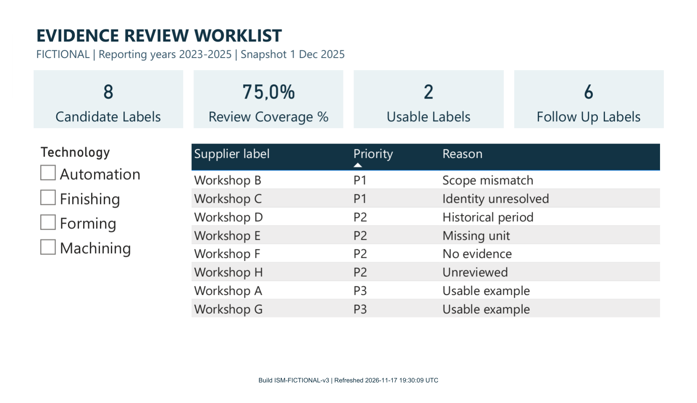

# ISM Supplier Sustainability Project

**College case study connected to a fictional Power BI evidence-review analysis.**

The decision: which supplier-evidence records should a reviewer follow up first, and why?

This edition uses eight invented workshops. It turns incomplete disclosures into an explicit review worklist, while keeping reporting period, unit, entity scope and uncertainty visible. It contains no original internal supplier data.



[View all three report pages](Power_BI_Report_Preview.pdf)

## What the scenario finds

| Result | Fictional outcome |
|---|---:|
| Candidate labels | 8 |
| Reviewed | 6 / 8 = 75% |
| Labels with usable example evidence | 2 / 8 = 25% |
| Follow-up cases | 6 |
| P1 identity or scope cases | 2 |
| P2 incomplete, old or unreviewed cases | 4 |

Workshop B needs site-level scope; C needs an identity decision. D needs an updated period, E a confirmed unit, F a source and H a completed review. A and G have usable example evidence under the scenario rules. These are priorities for evidence work, not environmental-performance ratings.

## Connect the original work to this edition

The starting point was Satyam Tomar's ISM academic team project in 2025. The supplied recovery guide records his reported contribution as helping with R/Excel preparation, assessment criteria, team Power BI work and presenting findings. Individual ownership of every original visual or measure is not established.

An October 2026 reconstruction and November 2026 report-definition audit prompted a new reporting approach: preserve raw records, define the unit being counted, and distinguish a reviewed record from usable evidence. This edition demonstrates that approach with invented data. Codex substantially assisted the reconstruction, implementation and testing. The original academic project, this scenario and personal independent proficiency have different evidence.

See [the case study](CASE_STUDY.md), [the presentation](ISM_Supplier_Sustainability_v3.pdf), and [the validation scope](VALIDATION.md).

[Editable PowerPoint](ISM_Supplier_Sustainability_v3.pptx) · [Three-minute walkthrough](INTERVIEW_WALKTHROUGH.md) · [Acceptance checklist](ACCEPTANCE_MATRIX.md)

## Explore in Power BI Desktop

Unzip the whole package or clone the repository. Open `ISM Supplier Sustainability v3.pbip`, then choose **Refresh**. First-open notices about empty data or relationships are expected until the literal-source refresh finishes. No external workbook or personal source path is required.

1. **Review Overview:** choose a technology and inspect eligible labels, review coverage, usable labels and follow-up counts. The table sorts P1 before P2 before P3. Equal-priority rows are tied; their order is not an additional ranking.
2. **Supplier Evidence:** choose exactly one workshop. Read the review reason and next action, then inspect source ID, scope, metric, year and reported value. An empty evidence table means no scenario claim exists.
3. **Data Quality:** reconcile 11 raw supplier cells to 10 occurrences and 8 labels, and 9 evidence rows to 8 distinct claims.

The report's embedded tables are a portable snapshot generated from the included public fictional inputs. Clicking Desktop Refresh refreshes that snapshot; changes to the CSVs require rerunning the reproducible workflow below first.

## Reproduce the complete analysis

Requirements: base R (tested with R 4.6.1), Python 3 standard library, and Power BI Desktop for the report. No R/Python packages need to be installed for these commands. From this package folder:

```text
Rscript --vanilla reproduce/analyse.R . r_outputs
python reproduce/refresh_snapshot.py r_outputs
python -m unittest discover -s reproduce -p test_*.py
```

Close Power BI Desktop before regenerating files; then reopen the PBIP and choose Refresh. The R script reads only `fictional_inputs/`, trims label whitespace, excludes the documented placeholder, preserves source rows, removes exact duplicate evidence rows, applies the evidence rules and writes `r_outputs/`. The Python adapter copies those results into the portable model. `analysis_outputs/r_model_snapshot.json` records model-table hashes and metrics. `analysis_outputs/input_hashes.json` records the supplied fixture's initial input hashes.

The acceptance tests are intentionally bound to the supplied fixture. If you change its inputs to run another scenario, revise the expected outcomes deliberately; a changed scenario should not silently pass the original fixture tests. `analysis_outputs/` includes the original comparison calculation snapshots; `r_outputs/` and `r_model_snapshot.json` are refreshed by the commands above.

## Worked analytical example

Workshop A reports invented site energy use of 1,500 MWh in 2023 and 1,200 MWh in 2024. The within-site change is `(1200 - 1500) / 1500 = -20%`. Both rows use the same metric, unit and site scope. B reports group-level intensity in kWh/unit, so it cannot be averaged with A's absolute energy use or used to rank A against B.

Selecting Machining gives 2 labels, 100% reviewed and 1 usable case. Finishing gives 2 labels, 50% reviewed and 0 usable cases. Selecting A plus H gives 50% review coverage. A's two source occurrences still count as one candidate label.

## Rules and model

See [metric and priority definitions](METHOD.md). Labels is one row per candidate label. Evidence is one row per deduplicated scenario claim. Occurrences retains source-row grain. Labels filters both facts through single-direction relationships. Technology is stored on Labels so that every measure uses the same filtered population. Percentages return blank for an empty eligible population. Some empty count populations display blank rather than zero; the zero-safe reviewed/usable/follow-up measures are explicit.

All source IDs beginning SIM identify authored fixture records. They are not real publications or fabricated citations. The research-as-of date is **1 December 2025** for this fictional exercise; the rebuild/testing date is **17 November 2026**. These dates serve different purposes.

## Package and privacy

The package contains the PBIP, inspectable model/report definitions, invented input CSVs, derived outputs, reproduction scripts, thirteen-slide editable PowerPoint, matching searchable PDF and validation notes. The PDF uses slide renders with a searchable text layer. The public data are entirely authored; they are not anonymised extracts from the internal workbook.

Original Excel/PBIX files, private research records, cached binary data models and old archives are excluded. The old GitHub repository must remain private. This analysis establishes no BMW endorsement, measured business savings, supplier ranking or certificate verification.

## Version 3 corrections

The snapshot adapter accepts both authored and native Desktop-saved column identifiers, reads the ordered literal-table header, validates every table before writing, stages replacements and rolls back completed replacements after an ordinary file-replacement error. Regression tests cover the native-save format, invalid model/input cases, complete claim-record equality and interrupted replacement. A sudden process or power loss across several files is not a database transaction; preserve the inputs and rerun regeneration if interrupted.

Five model tables are included: four analytical tables plus disconnected RefreshInfo. The footer shows the actual UTC model-refresh time and build ID ISM-FICTIONAL-v3. That timestamp is independent of the authored snapshot date and reporting-year window 2023-2025. Desktop Refresh updates the embedded snapshot and refresh clock; it does not reread the CSVs.

The presentation includes actual fictional report images, a worked 300%-versus-100% filter example and distinct chronology. Use INTERVIEW_WALKTHROUGH.md for the version-specific three-minute explanation. Personal contribution confirmation and rehearsal are pending.

R input-guard tests run when Rscript is on PATH or the RSCRIPT environment variable points to its executable; otherwise that test reports a skip. No additional R or Python libraries are required for the analysis/tests.
